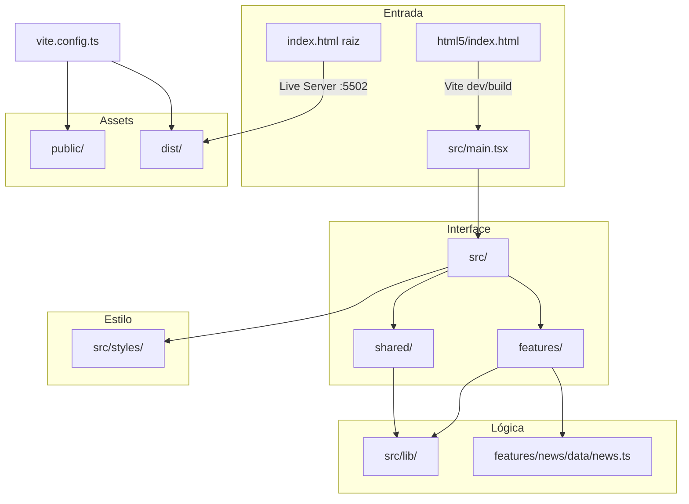

# Mapeamento de Estrutura — Mundo News

**Data:** 09/08/2026  
**Escopo:** Pasta raiz do projeto + contexto do ecossistema `Projetos/`

---

## 1. Árvore do Projeto (Raiz)

```
Projeto-BlogMundoNews/                    ← RAIZ DO REPOSITÓRIO
│
├── src/                                  ← Código-fonte da aplicação
│   ├── main.tsx                          ← Bootstrap React + HelmetProvider
│   ├── App.tsx                           ← Definição de rotas
│   ├── vite-env.d.ts
│   ├── features/                         ← Módulos por domínio
│   │   ├── news/
│   │   │   ├── pages/                    ← HomePage, CategoryPage, ArticlePage
│   │   │   ├── components/               ← NewsCard, BreakingTicker, EditorialBlock, SidebarSports
│   │   │   └── data/news.ts              ← Banco de dados estático (artigos + equipe)
│   │   ├── about/
│   │   │   ├── pages/AboutPage.tsx
│   │   │   └── components/               ← Correspondents, TruthBanner
│   │   ├── weather/components/           ← SidebarWeather
│   │   ├── markets/components/           ← TopBar (cotações)
│   │   └── horoscope/components/         ← SidebarHoroscope
│   ├── shared/
│   │   ├── components/                   ← Layout, Header, Footer, Sidebar, PageMeta, AppRouter, Logo
│   │   ├── pages/NotFoundPage.tsx
│   │   └── types/index.ts                ← NewsArticle, NewsCategory, Correspondent
│   ├── lib/                              ← Lógica compartilhada
│   │   ├── brand.ts                      ← Identidade visual, nav links
│   │   ├── seo.ts                        ← Metadados e JSON-LD
│   │   ├── router.ts                     ← Detecção Live Server vs produção
│   │   ├── markets.ts                    ← API cotações (Ibovespa, dólar)
│   │   ├── sidebarWeather.ts
│   │   ├── sidebarHoroscope.ts
│   │   ├── editorial.ts
│   │   ├── infoBar.ts
│   │   ├── constants.ts
│   │   └── utils.ts
│   └── styles/
│       ├── style.css                     ← Reset, variáveis CSS, layout base
│       └── components.css                ← Estilos por componente
│
├── html5/                                ← Entry point Vite
│   ├── index.html                        ← Página principal (meta SEO, fontes)
│   └── main.tsx                          ← Reexporta src/main.tsx
│
├── index.html                            ← Entry Live Server (gerado no build)
│
├── public/                               ← Assets estáticos (copiados no build)
│   ├── favicon.svg
│   ├── logo.svg
│   ├── logo-icon.svg
│   ├── og-image.svg
│   ├── apple-touch-icon.svg
│   ├── site.webmanifest
│   ├── robots.txt
│   ├── sitemap.xml                       ← Gerado automaticamente no build
│   ├── _redirects                        ← Netlify SPA fallback
│   └── noticias/
│       └── governo-contatos-eua-tarifas.png
│
├── tests/                                ← Testes E2E Playwright
│   ├── home.spec.ts
│   ├── article.spec.ts
│   ├── responsive.spec.ts
│   └── a11y.spec.ts
│
├── dist/                                 ← Build de produção (gerado, gitignored)
│   └── assets/
│       ├── index.js
│       └── index.css
│
├── docs/                                 ← Documentação profissional
│   ├── AUDITORIA-COMPLETA.md
│   ├── MAPEAMENTO-ESTRUTURA.md
│   └── PLANO-ORGANIZACAO.md
│
├── .github/workflows/ci.yml              ← CI: build + Playwright
├── node_modules/                         ← Dependências npm (gitignored)
│
├── .gitignore
├── package.json
├── package-lock.json
├── tsconfig.json
├── vite.config.ts
├── playwright.config.ts
└── README.md
```

---

## 2. Relação entre Pastas



---

## 3. Fluxo de Build

```
┌─────────────┐     npm run dev      ┌──────────────┐
│ html5/      │ ──────────────────►  │ Vite HMR     │
│ index.html  │                      │ localhost:5173│
└─────────────┘                      └──────────────┘

┌─────────────┐     npm run build    ┌──────────────┐
│ src/        │ ──────────────────►  │ dist/        │
│ html5/      │                      │ assets/      │
│ public/     │                      │ index.{js,css}│
└─────────────┘                      └──────────────┘
                                             │
                                             ▼
                                    index.html (raiz)
                                    Live Server :5502
                                    ou Netlify deploy
```

---

## 4. Mapeamento de Rotas

| Rota | Componente | Descrição |
|------|------------|-----------|
| `/` | HomePage | Página inicial com destaque |
| `/brasil` | CategoryPage | Notícias do Brasil |
| `/mundo` | CategoryPage | Notícias internacionais |
| `/opiniao` | CategoryPage | Colunas de opinião |
| `/esporte` | CategoryPage | Esportes |
| `/artigos` | CategoryPage | Artigos longos |
| `/noticia/:slug` | ArticlePage | Matéria individual |
| `/sobre` | AboutPage | Sobre / ética / equipe |
| `/*` | NotFoundPage | Página 404 |

**Nota:** Em produção e preview usa `BrowserRouter` (URLs limpas). No Live Server (porta 5502) usa `HashRouter` automaticamente.

---

## 5. Dependências entre Módulos

| Módulo | Importa de | Consumido por |
|--------|-----------|---------------|
| `@js/brand` | `public/logo*.svg` | Header, Footer, HomePage, Logo |
| `@js/utils` | — | NewsCard, ArticlePage, CategoryPage |
| `@js/markets` | APIs externas | TopBar |
| `@js/sidebarWeather` | Open-Meteo API | SidebarWeather |
| `@js/sidebarHoroscope` | — | SidebarHoroscope |
| `@js/editorial` | — | HomePage, EditorialBlock |
| `@js/seo` | `shared/types` | PageMeta, ArticlePage |
| `features/news/data/news` | `shared/types` | HomePage, ArticlePage, CategoryPage, BreakingTicker |
| `@css/style.css` | — | src/main.tsx |
| `@css/components.css` | — | src/main.tsx |

---

## 6. Pastas Fora da Raiz do Projeto

### 6.1 Contexto: `j:\area de trabalho\Fron_End\Projetos\`

O projeto **Mundo News** faz parte de um portfólio com **60+ projetos** na mesma pasta pai. Projetos irmãos relevantes por similaridade:

| Projeto | Relação com Mundo News |
|---------|------------------------|
| `Projeto-BlogMundoNews` | **Este projeto** — portal de notícias |
| `Projeto-Cinefly` | Possível referência de layout media |
| `Projeto-Culturama` | Possível referência cultural |
| `MyHype` / `Projeto-MyHype` | Variantes de branding |
| Demais 55+ projetos | Portfólio independente (e-commerce, serviços, etc.) |

### 6.2 Pastas do sistema (fora do repositório)

| Caminho | Conteúdo | Relação |
|---------|----------|---------|
| `node_modules/` | Dependências npm | Gerado por `npm install` |
| `dist/` | Build compilado | Gerado por `npm run build` |
| `.git/` | Histórico Git | Controle de versão |
| `.cursor/` | Config Cursor IDE | Ferramentas locais (gitignored) |
| `C:\Users\jorge\.cursor\projects\...` | Terminais, transcripts | Ambiente de desenvolvimento |

### 6.3 Serviços externos (nuvem)

| Serviço | URL | Função |
|---------|-----|--------|
| Netlify | https://mundonwes.netlify.app/ | Hospedagem produção |
| GitHub | https://github.com/JorgeRamalho/Mundonews | Repositório remoto |
| Google Fonts | fonts.googleapis.com | Tipografia |
| AwesomeAPI | economia.awesomeapi.com.br | Cotação dólar |
| Yahoo Finance | query1.finance.yahoo.com | Ibovespa |
| Open-Meteo | api.open-meteo.com | Previsão do tempo |
| AllOrigins | api.allorigins.win | Proxy CORS (fallback) |

---

## 7. Estrutura Atual (pós Fase 4)

A migração para `src/` com separação por features foi concluída em 09/08/2026.

```
src/
├── main.tsx
├── App.tsx
├── features/     ← news, about, weather, markets, horoscope
├── shared/       ← components, pages, types
├── lib/          ← brand, seo, router, APIs
└── styles/       ← style.css, components.css
public/           ← assets servidos na raiz
html5/            ← entry Vite
index.html        ← entry Live Server (gerado no build)
```

Aliases TypeScript/Vite: `@/*` → `src/*`, `@js/*` → `src/lib/*`, `@css/*` → `src/styles/*`

---

## 8. Arquivos por Responsabilidade

| Responsabilidade | Localização |
|------------------|-------------|
| SEO / meta tags | `shared/components/PageMeta.tsx` + `src/lib/seo.ts` |
| Rotas | `src/App.tsx` |
| Layout global | `src/shared/components/Layout.tsx` |
| Conteúdo editorial | `src/features/news/data/news.ts` |
| Identidade de marca | `src/lib/brand.ts` |
| Design tokens | `src/styles/style.css` (`:root`) |
| Configuração build | `vite.config.ts` |
| Tipos TypeScript | `src/shared/types/index.ts`, `tsconfig.json` |
| PWA manifest | `public/site.webmanifest` |
| Testes E2E | `tests/`, `playwright.config.ts` |
| CI | `.github/workflows/ci.yml` |

---

*Mapa estrutural atualizado após Fase 4 — 09/08/2026.*
